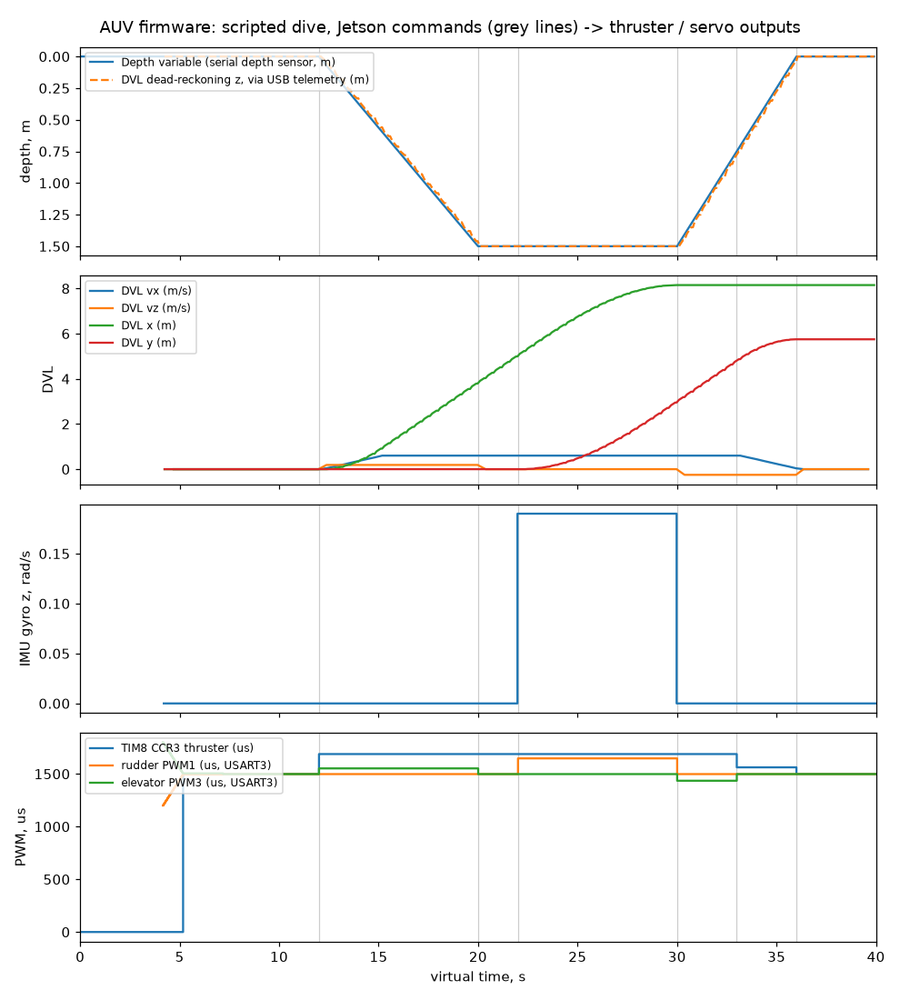
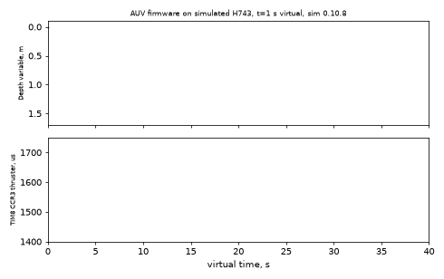
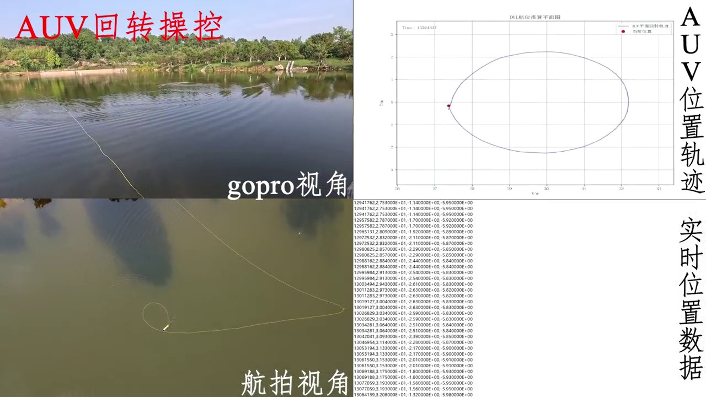

<!-- simantic-banner -->
> **Run this firmware with no hardware.** [Simantic](https://simantic.com) simulates the whole board, peripherals, sensors and buses included. Try it free at **[simantic.com](https://simantic.com)**, or run it locally: `curl -fsSL https://simantic.com/install | sh`

## This fork: the AUV firmware on a simulated STM32H7, with a scripted dive

Unofficial demo fork of [ros2xiaobai/underactuated-auv-stm32-ros](https://github.com/ros2xiaobai/underactuated-auv-stm32-ros); all credit for the firmware goes to its author. The upstream repository has no license file, so nothing here is a grant of rights: this fork only adds a `sim/` folder, this README section and one `.gitignore` line, and no upstream source file is changed. Not affiliated with the author.

The unmodified STM32H750 firmware (FreeRTOS, MTi IMU, DVL, serial depth sensor, thruster PWM, Jetson link) is built with
arm-none-eabi-gcc and runs in the Simantic simulator, wired to five Python peers. Everything is in [`sim/`](sim/).

```
cd sim && make && ./run.sh     # needs sim on PATH, arm-none-eabi-gcc; the plot needs python3 + matplotlib (PYTHON=... ./run.sh)
```





*Re-run on `sim` 0.10.8 (build 64f89c38), 2026-11-25: 40 s of virtual time with memory tracing, 4020 ATKP frames and 0 bad checksums, `sim/measured.txt` unchanged from the 0.10.5 run. Animation from `sim/run.log` (the firmware's Depth variable and TIM8 CCR3 writes, with the Jetson peer's commands marked), drawn by `sim/make_gif.py sim/run.log sim/dive.gif "sim 0.10.8"`. The depth profile is the scripted stimulus, not a vehicle model.*

**What is attached** (`sim/scenario.yaml`): MTi-630 IMU on UART4 (100 Hz, big-endian XDI records), serial depth sensor on UART8
(`T=..D=..`, 10 Hz), DVL on USART1 (`wrz`/`wrp` lines with CRC-8, 5 Hz), the Jetson on USART2 (ATKP frames, 57600; the peer sends the
dive commands), and the rudder/elevator sub-controller on USART3 (the firmware prints its servo commands there as text).
The thruster output is read from the TIM8 CCR3 register. The firmware's USB CDC telemetry (what the Jetson would read) is decoded from the simulator console.
The dive profile (`sim/auvprofile.py`) is a **scripted trajectory, not a vehicle model**: the firmware is open loop, so nothing is fed back.

**Measured, from a real run** (`sim` 0.10.5, [`sim/run.log`](sim/run.log), 40 s of virtual time, about 50 s of wall clock with memory tracing; [`sim/measured.txt`](sim/measured.txt)):

    ATKP frames decoded from USB CDC: 4020 good, 0 bad checksum
      0x01 acc/gyro: 3576 frames, first at 4.202 s, last at 39.998 s
      0x08 position: 267 frames, first at 4.242 s, last at 39.908 s
      0xF2 DVL velocity: 88 frames, first at 4.702 s, last at 39.608 s
      0x20 PWM: 89 frames, first at 4.552 s, last at 39.808 s
    Jetson commands sent on USART2: 6: 12.0s 0x51; 20.0s 0x51; 22.0s 0x51; 30.0s 0x51; 33.0s 0x51; 36.0s 0x02
    TIM8 CCR3 (thruster) writes: 17926; first write after boot 1500 us at 5.173 s; first non-neutral value 1688 us at 12.002 s; after the 12 s command: 1688 us; after the 33 s command: 1562; after stop (36 s): 1500
    TIM8 CCR3 stabilizer loop catch-up: 1573 writes between 7.1 and 7.3 s (loop period is 2 ms: nominal 100); median gap 33 us
    TIM8 CCR3 steady period 8..35 s: median 2.000 ms (13500 writes)
    USART3 servo lines: 5553; at 10 s 1498,1502,1498,1502 us (PWM1..4); at 14 s 1498,1552 (rudder, elevator); at 24 s 1647,1498; at 31 s 1498,1435; at 37 s 1498,1498
    Depth variable: 359 writes, 358 plausible; max 1.500 m at 20.0 s; at 20 s 1.481 m (profile 1.500), at 36 s 0.025 m
    Depth variable implausible values: 3.8740886706195135e-34 at 4.201 s
    DVL vx at 18 s 0.600 m/s (profile 0.600); vz at 16 s 0.188 m/s (profile 0.1875)
    DVL dead-reckoning at 36 s: x 8.15 m, y 5.75 m, z 0.05 m
    IMU gyro z reported at 26 s: 0.19 rad/s (profile 0.196, the firmware truncates to 0.01 rad/s)

What this shows: the whole chain works as written. The IMU, depth and DVL streams are parsed (depth reaches 1.5 m, DVL vx 0.600 m/s), the Jetson commands arrive and
set the thruster to 1688 us (command 120) and the rudder/elevator servo values (PWM = 1200 + 600 x value/255), and the telemetry frames all pass the ATKP checksums.
The sensor values come from the scripted profile, so agreement with the profile shows the parsers and links work, not that the vehicle would dive.

**What had to be added to build it** (all under `sim/`, none changes upstream source): the upstream project is Keil MDK-ARM only, so there is a
`Makefile`, a CubeMX-style linker script for the STM32H750VB (128 KB flash; the image is 101 KB of flash), the GCC startup file from ST's CMSIS templates,
the FreeRTOS V10.3.1 GCC ARM_CM4F port (upstream ships only the Keil/RVDS port), and `syscalls.c`, which maps newlib's `_write` to the firmware's own `fputc` (console on LPUART1). Warnings are silenced with `-w`.

**Chip used:** the released simulator has no STM32H750 part, so the run uses **STM32H743VI** (same die family: the H750 is the 128 KB flash part, without the crypto block). Nothing here depends on the difference, but it is not a claim about H750 silicon. No hardware comparison has been done.

**Findings** (firmware behaviour, observed in the sim; not reported upstream):
- `stabilizerTask` takes `lastWakeTime` before its roughly 3 s start-up sequence, so `vTaskDelayUntil` runs about 1500 loop iterations back to back after it: 1573 TIM8 CCR3 writes about 33 us apart at 7.17 s, then 2.000 ms steady.
- No control loop runs: `state1Control` is never called, `Mode` and the 0x41 yaw/speed setpoint are stored and never used, and `Heading_control`/`Depth_control` are commented out. Only the thruster reaches a timer (TIM8 CCR3); rudder and elevator values go out as text on USART3.
- The depth callback ignores the result of `sscanf`. A partial first line left `depth` uninitialised, and the value 3.9e-34 (the bits of a flash address) was queued as a depth sample at 4.201 s.
- `CDC_Transmit_FS` returns `USBD_BUSY` and the caller ignores it, dropping the whole packed buffer. Over 36 s only 267 position frames (nominal 10 Hz, about 360) and 88 DVL velocity frames (nominal 5 Hz, about 180) arrived. How much of this is real USB timing is unverified: no silicon run.
- Telemetry goes to USB only (`Uart2linkSendPacket` is commented out), so USART2 is receive-only in this tree. Euler angles and depth are never sent to the Jetson.

---

Everything below is the upstream README.

# Torpedo-Shaped Underactuated AUV

基于 STM32H750 与 Jetson Nano 的鱼雷型欠驱动自主水下航行器项目。STM32 端运行 FreeRTOS，负责多传感器采集、组合导航、实时控制和执行机构输出；Jetson 端运行 ROS 1，负责串口数据接入、航点管理、期望航向计算、控制帧下发以及航迹可视化。

> 当前仓库由嵌入式固件和多个阶段的 ROS 程序整理而成。代码能够说明各模块的设计与接口，但本次整理没有重新完成 ROS 编译、固件烧录、整艇联调或下水验证。不同保留版本之间仍存在消息类型、协议字段和坐标系差异，使用前必须按实际部署版本复核。

## 项目展示



现有湖试视频同步展示了现场画面、航拍画面、DVL 实时位置数据和二维轨迹，包含回转、上浮、下潜与直航片段。画面中可见安全／回收绳，因此这里将其作为受控条件下的系统联调证据，不据此单独声称已经完成无缆自主航行或导航性能验收。

- [观看完整湖试视频](docs/testing/assets/lake-test/lake-test-demo.mp4)
- [查看湖试材料说明与证据边界](docs/testing/lake-test-demo.md)
- [查看 STM32H750 控制板原理图](docs/hardware/schematics/stm32h750-auv-controller-v1.pdf)
- [查看硬件接口与固件映射](docs/hardware/interface-map.md)
- [查看项目实际使用的 ATKP 风格协议](docs/protocol/auv-atkp-profile.md)

## 主要功能

### STM32 下位机

- 读取 MTi 系列 IMU 的加速度、角速度和姿态数据。
- 读取 DVL 速度、位置和姿态相关数据。
- 解析 GPS/RTK 定位与航向信息。
- 读取串口深度传感器数据。
- 使用 INS/EKF 相关模块进行 IMU 与 DVL 的位置、速度融合。
- 使用 FreeRTOS 管理传感器接收、融合、通信和控制任务。
- 通过 PWM 和串口向推进器、舵机或下级控制器输出指令。
- 通过 USB CDC 或 USART2 与上位机交换 ATKP 风格数据帧。

### Jetson／ROS 上位机

- 通过串口接收 STM32 上传的数据并解析姿态、深度、位置、GPS 和 DVL 报文。
- 发布当前位置、航向及其他导航信息，支持文件日志记录。
- 使用航点队列管理目标经纬度，并将经纬度转换为 UTM 平面坐标。
- 根据当前位置与目标点计算期望航向，发布 `/cmd_heading` 和 `/los`。
- 将期望航向封装为 `0x41` 控制帧并通过串口发送给 STM32。
- 使用 `nav_msgs/Path`、TF 和 RViz 显示航迹。
- 保留 RViz 地图点击选点、UTM/经纬度转换和 `/geopoint` 航点输入的实验代码。

## 硬件与软件环境

| 层级 | 项目 | 配置 |
| --- | --- | --- |
| 下位机 | MCU | STM32H750VBT6，Cortex-M7，LQFP100 |
| 下位机 | 主频 | 480 MHz（HCLK 240 MHz） |
| 下位机 | 固件库 | STM32Cube FW_H7 V1.12.1 |
| 下位机 | RTOS | FreeRTOS Kernel V10.3.1，CMSIS-RTOS v2 接口 |
| 下位机 | 开发工具 | Keil MDK-ARM、STM32CubeMX |
| 上位机 | 计算平台 | Jetson Nano |
| 上位机 | 中间件 | ROS 1、catkin；保留工作空间指向 ROS Noetic |
| 上位机 | 主要依赖 | roscpp、rospy、serial、TF2、GeographicLib、geographic_msgs、nav_msgs |
| 通信 | STM32 ↔ Jetson | USB CDC／串口，115200 bit/s 的保留配置 |

ROS 发行版、Jetson 系统镜像、设备名和依赖版本需以实际部署环境为准；表中内容来自当前工程与保留工作空间，不代表本轮重新安装验证。

## 系统架构

```text
IMU ─┐
DVL ─┼─> STM32H750 / FreeRTOS ──> INS/EKF、状态维护、实时控制
GPS ─┤            │
深度 ─┘            ├─> 推进器 / 舵机
                   │
                   └─ USB CDC / ATKP 风格帧
                                │
                                v
                      Jetson Nano / ROS 1
                   ┌────────────┼─────────────┐
                   │            │             │
              串口解析      航点与导引     RViz/轨迹记录
                   │            │
                   └──── /current_gps ──> /los
                                              │
                                      0x41 控制帧下发
```

这是一条设计链路。当前保留的 STM32 固件、ROS 主线和 RViz 扩展并非已经确认完全一致的同一套运行版本，接口差异见 [`docs/ros-integration.md`](docs/ros-integration.md)。

## 目录结构

```text
.
├─ Core/                 # STM32 初始化、中断与 FreeRTOS 对象
├─ HARDWARE/             # IMU、深度传感器和公共数据类型
├─ DVL/                  # DVL 数据接收与解析
├─ GPS/                  # GPS/RTK 数据接收与解析
├─ EKF/                  # 惯导参数、矩阵运算与融合任务
├─ PID/                  # PID 算法与参数结构
├─ stabilizer/           # 稳定控制主循环
├─ moter/                # 推进器和舵机输出（保留原目录名）
├─ COMMUNICATE/          # ATKP、USB CDC 与 USART2 通信
├─ WS2812/               # WS2812 状态灯驱动
├─ USB_DEVICE/           # USB CDC 设备代码
├─ Drivers/              # CMSIS 与 STM32 HAL
├─ Middlewares/          # FreeRTOS 与 USB Device 中间件
├─ MDK-ARM/              # Keil 工程与历史构建文件
├─ ros1_ws/
│  ├─ README.md          # ROS 源码来源、节点和安全说明
│  ├─ src/
│  │  ├─ serial_send_gps/# 串口接收、导引、下发和日志主包
│  │  └─ serial_node/    # 早期串口、消息与轨迹实验包
│  └─ experimental/
│     └─ rviz_map/       # 地图点击选点与 GeoPoint 导引扩展
├─ docs/
│  ├─ hardware/          # 控制板原理图与硬件接口映射
│  ├─ protocol/          # 项目协议剖面与第三方参考说明
│  ├─ testing/           # 湖试视频、截图与证据边界
│  ├─ ros-integration.md # ROS/STM32 接口核对与迁移清单
│  └─ source-inventory.md # 源码来源、版本和完整性清单
├─ archive/              # 历史源码、基线快照和整理前版本
│  ├─ stm32_variants/   # STM32 整理前差异版本
│  ├─ ros_history/      # sunyan.zip 中 4 个历史 src 工作空间
│  ├─ ros_baseline/     # 2025-04-03 ROS 源码基线
│  └─ source_notes/     # 原始材料来源说明
├─ SOURCE_MANIFEST.sha256 # 拟上传文件的 SHA-256 清单
├─ IMUDMA.ioc            # STM32CubeMX 配置
└─ README.md
```

`ros1_ws/src` 继续以 `zuizhong/02_Jetson_ROS_Latest` 作为 ROS 主线。`sunyan.zip` 中的 4 个历史 `src` 树已分别保存在 `archive/ros_history/`，`2025-04-03` 测试基线保存在 `archive/ros_baseline/`。压缩包中的 `build/`、`devel/` 属于可重新生成的 catkin 产物，没有混入源码树。

## 源码完整性与版本组织

- STM32 主线已按 `01_STM32_H750_Firmware` 核对；整理前存在内容差异的文件先备份到 `archive/stm32_variants/pre-final-merge/`，再恢复可信源版本。
- ROS 主线保留 `02_Jetson_ROS_Latest` 的全部 35 个文件；根 `CMakeLists.txt` 使用可直接提交 Git 的 catkin 顶层写法，而不保留本机绝对路径软链接。
- `sunyan.zip` 里 4 个历史工作空间的源码均已独立归档，没有与主线同名 ROS 包混合编译。
- RViz 扩展已补全 launch、Python/C++ 节点、YAML 及 5 个地图栅格/辅助文件。
- 测试日志与原始数据没有当作源码上传，但原始目录未被删除或改写。

详细的源目录、放置位置、文件数和例外说明见 [`docs/source-inventory.md`](docs/source-inventory.md)。`SOURCE_MANIFEST.sha256` 用于在上传前后核对拟纳入 Git 的文件内容。本轮整理没有重新执行 Keil 编译、catkin 编译、固件烧录或整艇实验。

## STM32 接口分配

| 外设 | 引脚 | 参数 | 当前用途 |
| --- | --- | --- | --- |
| UART4 | TX: PC10，RX: PA1 | 2,000,000，8N1 | IMU 数据 |
| UART8 | TX: PE1，RX: PE0 | 115,200，8N1 | 深度传感器 |
| USART1 | TX: PA9，RX: PA10 | 115,200，8N1 | DVL |
| USART2 | TX: PA2，RX: PA3 | 57,600，8N1 | 上位机／外部 ATKP 链路 |
| USART3 | TX: PB10，RX: PB11 | 115,200，8N1 | 舵机／下级控制器指令 |
| USART6 | TX: PC6，RX: PC7 | 115,200，8N1 | GPS/RTK |
| LPUART1 | TX: PB6，RX: PB7 | 209,700，8N1 | 调试输出与数据转发 |
| USB FS | PA11 / PA12 | CDC | Jetson／上位机虚拟串口 |
| SPI4 | 见 `IMUDMA.ioc` | 主机、单向发送、3.75 Mbit/s | WS2812（DMA） |
| TIM1 CH1–CH4 | PE9、PE11、PE13、PE14 | PWM | 已配置航向／深度输出，当前启动路径未全部启用 |
| TIM8 CH3–CH4 | PC8、PC9 | PWM | CH3 用于推进输出；CH4 已启动并预留 |

PWM 参数集中在 `moter/moter.h`。当前 `Control_PWM_Set()` 的有效路径包括推进输出和 USART3 舵机指令；不能仅凭已定义的 TIM1 通道断言直接 PWM 舵机路径已经启用。

## ROS 节点与话题

以下是当前源码中与主链路最相关的节点。CMake 中还保留输入、半程导引和测试程序，它们是不同阶段的实验入口，不应全部同时启动。

| 源文件／节点 | 订阅 | 发布或输出 | 作用 |
| --- | --- | --- | --- |
| `usb_datarecv_fixing1.cpp` | STM32 串口 | `current_gps`、日志文件 | 解析多类上行帧，发布 GPS/姿态相关数据 |
| `usb_datarecv2.cpp` | STM32 串口 | `current_gps` | 另一版 GPS 数据接收与发布入口 |
| `los_s_result.cpp` | `/target_gps`、`/current_gps`、`/start_cmd` | `/cmd_heading`、`/los` | 航点队列、UTM 转换、距离判断和期望航向计算 |
| `serial_send_losdata.cpp` | `/los` | STM32 串口、CSV | 将导引角封装为 `0x41` 控制帧 |
| `gps_path.cpp`／`test_node.cpp` | GPS 话题 | `gps_path`、TF | 轨迹和坐标系可视化 |
| `show_coordinate.py` | `/clicked_point` | `/geopoint` | RViz 点击点到地理坐标的实验转换 |
| `los_s_result_geopoint.cpp` | `/geopoint`、`/current_gps`、`/start_cmd` | `/cmd_heading`、`/los` | 接收地图选点的导引扩展 |

当前代码中的“LOS”主要是由当前位置指向目标点的方位角计算，再转换为航向角发布。源码中没有完整实现带横向误差和前视距离的路径跟踪律，因此文档采用“基于目标点的 LOS／期望航向计算”表述。

## 软件流程

### STM32 下位机

1. `Core/Src/main.c` 初始化时钟、GPIO、DMA、UART、SPI、USB 和定时器。
2. 启动 FreeRTOS 后，IMU、DVL、GPS 和深度任务使用 UART Receive-to-Idle + DMA 接收数据。
3. 接收回调解析报文，并通过消息队列或信号量通知后续任务。
4. INS/EKF 任务消费传感器数据，更新融合位置和速度。
5. `stabilizerTask` 按周期刷新控制输出。
6. 通信任务封装遥测上行帧并解析来自 ROS／上位机的控制帧。

### Jetson／ROS 上位机

1. 串口节点打开 `/dev/ttyUSB0` 或 `/dev/ttyACM0`，接收 STM32 数据。
2. 解析节点按消息 ID 提取数据并发布 ROS 话题，同时记录日志。
3. 导引节点等待 `/start_cmd`，维护目标点队列。
4. 当前点和目标点转换到 UTM 坐标，计算距离与期望航向。
5. 发布 `/cmd_heading` 和 `/los`。
6. 下发节点把 `/los` 封装为控制帧，经串口交给 STM32。
7. 轨迹节点通过 `nav_msgs/Path` 和 TF 向 RViz 提供显示数据。

## 编译

### STM32 固件

1. 安装 Keil MDK-ARM 和 STM32H7 Device Family Pack。
2. 打开 `MDK-ARM/IMUDMA.uvprojx`。
3. 选择 `IMUDMA` Target，执行 Build/Rebuild。
4. 使用 ST-Link 下载前，确认目标芯片为 `STM32H750VBTx`。

历史工程配置生成 HEX 文件，但本轮没有重新编译；应以本机重新构建结果为准。

### ROS 1 工作空间

源码按 catkin 工作空间整理在 `ros1_ws/src/`：

```bash
cd ros1_ws
catkin_make
source devel/setup.bash
```

编译前需安装与所用 ROS 发行版对应的 `serial`、TF2、GeographicLib、`geographic_msgs`、`geodesy`、`nav_msgs` 和 `visualization_msgs` 等依赖。本轮未在 Jetson／ROS 环境中重新执行 `catkin_make`；现有源文件保留了阶段性接口，编译成功也不代表可直接进行实艇闭环。

## 建议的首次联调顺序

1. 断开推进器动力，先验证 STM32、Jetson 和传感器供电与公共地。
2. 单独运行 STM32，检查 IMU、DVL、GPS 和深度数据。
3. 只运行 ROS 串口接收节点，确认帧头、消息 ID、长度、校验和和单位。
4. 使用 `rostopic echo` 核对 `/current_gps` 的消息类型及字段，不启动控制帧下发。
5. 使用人工或日志数据测试航点队列、UTM 转换、到达判据和 `/los` 输出。
6. 在 RViz 中核对 `map`、`utm`、`path` 等 frame，以及地图原点和 UTM 区带。
7. 对照 STM32 的 `0x41` 解析代码，统一字段位置、缩放、符号和双校验。
8. 只有完成协议回环和拆桨台架测试后，才启用 `serial_send_losdata` 与执行机构。

## 通信协议

USB CDC 与 USART2 使用 ATKP 风格帧：

```text
0xAA 0xFF MSG_ID DATA_LEN DATA... CHECKSUM ADD_SUM
```

- `DATA_LEN` 表示数据区长度。
- `CHECKSUM` 为从帧头到数据区的逐字节累加和。
- `ADD_SUM` 为每一步 `CHECKSUM` 的再次累加和。
- STM32 端消息定义和处理位于 `COMMUNICATE/atpk.c`、`COMMUNICATE/atpk.h` 与 `COMMUNICATE/usblink.c`。
- ROS 端串口解析和控制帧构造位于 `ros1_ws/src/serial_send_gps/src/`。

当前 ROS 接收代码的校验逻辑被注释，控制下发代码将 `ADD_SUM` 固定为 0；这些内容需要与 STM32 当前协议统一后才能作为可靠闭环接口使用。

## 已知版本边界

- `usb_datarecv_fixing1.cpp` 发布 `serial_send_gps/usb_gps`，而 `los_s_result.cpp` 订阅 `serial_send_gps/gps`；话题同名不能消除消息类型差异。
- STM32 GPS 上行函数与 ROS 保留解析版本在字段顺序、长度和 `10^7`／`10^8` 缩放上存在差异。
- ROS 下发程序把 LOS 写入控制帧第一个 `int16`，而已读 STM32 版本从其他字节位置读取航向控制量。
- 接收状态机在每次 `read()` 后重新建立，跨 read 的半帧处理与校验仍需完善。
- `gps_active.launch` 调用了当前 CMake 中未启用的旧节点，不能直接视为一键运行入口。
- RViz 选点脚本直接使用点击点 x、y 和固定 UTM 区带；实际使用还需核对 frame、地图原点和 TF。
- 当前仓库没有重新完成 ROS 编译、串口回环、台架或实艇验证，也不据此给出导航精度或控制效果结论。

更完整的文件级核对见 [`docs/ros-integration.md`](docs/ros-integration.md)。

## 常用修改位置

| 需求 | 文件 |
| --- | --- |
| 修改 STM32 时钟和外设 | `Core/Src/main.c`、`IMUDMA.ioc` |
| 修改串口参数 | `Core/Src/usart.c`、`IMUDMA.ioc` |
| 修改 FreeRTOS 任务和队列 | `Core/Src/freertos.c` |
| 修改上位机帧协议 | `COMMUNICATE/atpk.c`、`COMMUNICATE/atpk.h`、`COMMUNICATE/usblink.c` |
| 修改 PID 和执行输出 | `stabilizer/`、`PID/`、`moter/` |
| 修改 ROS 串口接收 | `ros1_ws/src/serial_send_gps/src/usb_datarecv_fixing1.cpp` |
| 修改 ROS 航点与期望航向 | `ros1_ws/src/serial_send_gps/src/los_s_result.cpp` |
| 修改 ROS 控制帧下发 | `ros1_ws/src/serial_send_gps/src/serial_send_losdata.cpp` |
| 修改 ROS 消息 | `ros1_ws/src/serial_send_gps/msg/`、`ros1_ws/src/serial_node/msg/` |
| 修改 RViz 地图选点 | `ros1_ws/experimental/rviz_map/` |

## 注意事项

- **上电后执行机构可能动作。** 调试时应拆除桨叶或断开推进器、舵机动力。
- ROS 源码中存在直接打开 `/dev/ttyACM0`、`/dev/ttyUSB0` 并发送控制帧的程序，运行前必须确认设备映射。
- ROS 节点名、话题名或源文件存在，不等于该节点已加入当前启动流程或完成实艇闭环。
- CMake 生成的多个可执行文件是不同阶段的入口，不等于需要同时运行的节点数量。
- 高频串口打印、回调内阻塞发送和未检查队列写入结果可能影响实时性。
- STM32H7 启用 D-Cache 时，DMA 缓冲区需要处理缓存一致性。
- 地图栅格属于场景相关素材，本次只保留配置与转换代码，没有复制大幅地图图片。

## 许可证

STM32 HAL、CMSIS、FreeRTOS、USB Device、ROS 依赖及其他第三方组件分别受其自身许可证约束。当前工程未提供覆盖全部自定义业务代码和历史 ROS 程序的统一顶层许可证；复制、分发或商用前，请先确认代码来源与授权范围。
