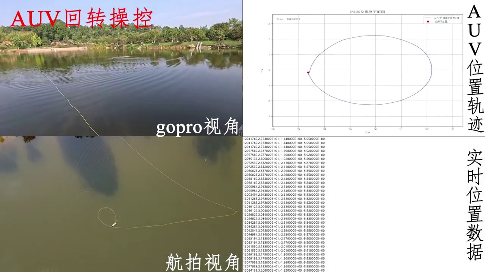
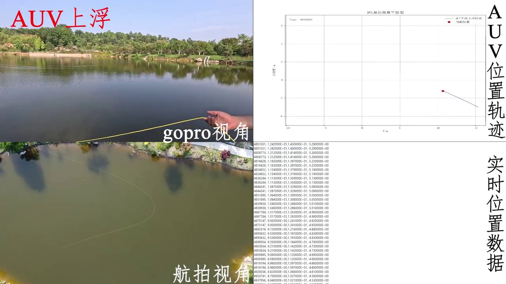
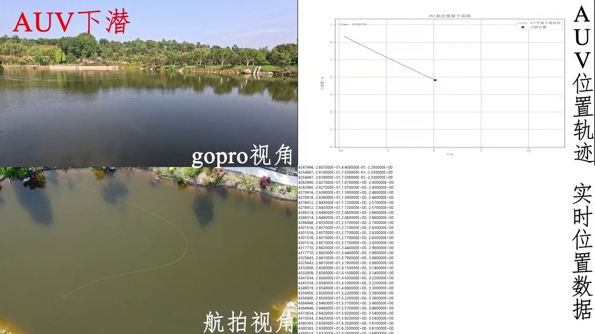
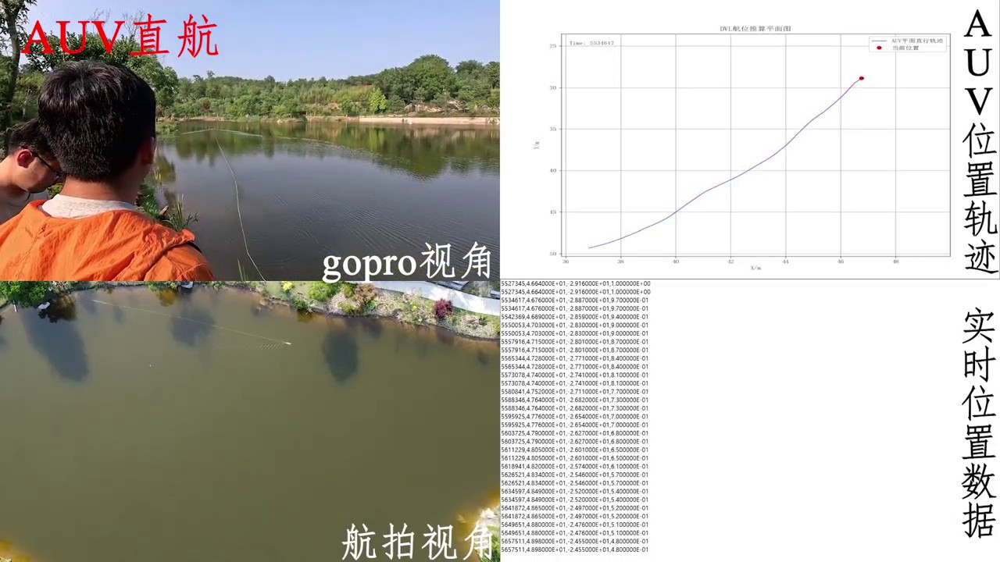

# AUV 湖试展示材料说明

## 媒体信息

| 项目 | 内容 |
| --- | --- |
| 文件 | `assets/lake-test/lake-test-demo.mp4` |
| 时长 | 约 61.8 s |
| 画面 | 1280 × 720，H.264，约 29 fps |
| 文件大小 | 约 9.96 MB |

视频采用多画面形式同步展示现场视角、航拍视角、DVL 实时位置数据和二维轨迹图。

## 片段索引

| 大致时间 | 画面内容 | 可以支持的结论 |
| --- | --- | --- |
| 0–10 s | 标题、艇体示意和设计参数 | 说明项目背景和视频自述参数 |
| 15–31 s | AUV 回转 | 可见艇体完成回转，DVL 数据和轨迹同步变化 |
| 35–42 s | AUV 上浮 | 可见升沉方向运动与位置数据更新 |
| 46–49 s | AUV 下潜 | 可见下潜片段与轨迹更新 |
| 52–58 s | AUV 直航 | 可见直线航行片段与 DVL 轨迹 |

## 代表性画面

### 回转

### 上浮与下潜

### 直航

## 视频中给出的设计参数

以下数据来自视频说明页，当前仓库没有对应的第三方检测报告或完整试验记录，因此只能标为“资料标称／设计参数”，不能写成实测性能：

| 参数 | 视频标称值 |
| --- | ---: |
| 总长 | 1.38 m |
| 主体长度 | 0.7 m |
| 最大直径 | 0.15 m |
| 干重 | 20.4 kg |
| 耐压深度 | 200 m |
| 航速 | 1–2.5 m/s |
| 推进器额定功率 | 390 W |
| 续航 | 6 h |

## 证据边界

- 画面中可见安全／回收绳，无法仅凭视频认定为完全无缆自主航行。
- 视频能够支持 DVL 数据获取和轨迹绘制，但不能证明绘图程序就是当前仓库中的 ROS/RViz 版本。
- 视频没有给出试验日期、控制模式、目标轨迹、误差统计和原始日志，因此不能据此给出定位精度或控制误差。
- 回转、升沉和直航画面可以作为系统联调展示，不等同于性能验收报告。
- 对外公开前应确认视频、校徽、团队名称、原理图以及出镜人员具有公开授权。

## 后续建议

若要把这段材料升级为可复现试验，建议补充试验日期与地点、固件提交号、ROS 提交号、DVL 型号与配置、控制模式、初始条件、目标量、原始日志、误差指标和安全措施。
